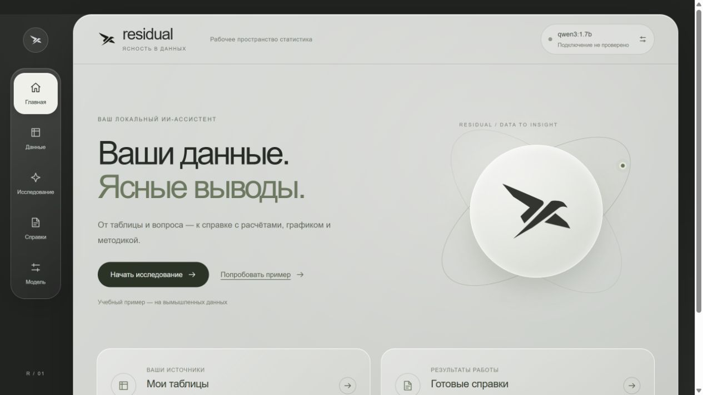

# Residual

**Ask a question about your table. Review the plan. Reproduce the answer.**

[](https://github.com/UNUEX/residual/actions/workflows/tests.yml)
[](LICENSE)

Residual is a local application for people who need a clear, checkable summary of a spreadsheet. Import a table, confirm what its columns mean, and ask for a mean, median or total. A language model proposes a limited analysis plan; Python calculates the values after you approve it.

The result includes a chart, missing-value counts, method, source hashes and a standalone Python export. You can reproduce the calculation without a language model.

**Early release.** The interface is currently in Russian. Documentation is in English. Windows has been tested locally; automated checks also run on Linux. This is a single-user application served on your own computer.



## Try it

### Windows

1. Install [Python 3.11–3.13](https://www.python.org/downloads/); enable **Add Python to PATH**.
2. [Download the source ZIP](https://github.com/UNUEX/residual/archive/refs/heads/main.zip), extract it, and open `start_residual.cmd`.
3. Open `setup_local_ai.cmd` once to install the portable Ollama runtime and `qwen3:1.7b`. This downloads the model to your computer. You can instead configure an existing Ollama installation or a compatible model API in **Модель**.
4. Open [localhost:8766](http://127.0.0.1:8766/), select **Попробовать пример**, and open the sample Excel table. Confirm the column descriptions, then ask for a mean by school type.
5. Review the proposed operation and columns, then select **Подтвердить и рассчитать**. Open the report to inspect or export the result.

Initial dependency and model installation needs internet access. Subsequent local inference has no per-request API fee; it uses your computer's memory, processor and electricity. External API charges depend on your provider. Close the application with `stop_residual.cmd`.

### macOS and Linux

With Python 3.11–3.13 installed:

```sh
git clone https://github.com/UNUEX/residual.git
cd residual
bash start_residual.sh
```

Install [Ollama](https://ollama.com/) separately, start it, and run `ollama pull qwen3:1.7b`. The shell launcher has not been independently tested on macOS. You can also run the application manually:

```sh
python -m venv .venv
# Activate .venv using your shell's normal command, then:
python -m pip install -r requirements.txt
python -m src.serve --port 8766
```

## What it does

- Imports CSV, TSV, Excel (`.xlsx`, `.xls`) and HTML tables; lets you choose a sheet, table and header row.
- Records column roles, units, period, observation unit and missing-value codes before analysis.
- Proposes a mean, median or sum for up to five numeric fields, optionally grouped by one category.
- Requires approval before calculation; unsupported and ambiguous requests are rejected or clarified.
- Saves reports and exports HTML, CSV, JSON, normalized source data and reproducible Python.
- Uses local Ollama or an explicitly configured compatible HTTPS API. There is no automatic cloud fallback.

The model receives your question and confirmed column metadata. Source rows and calculated results are not sent to the planner. Questions and metadata can still contain sensitive information. API keys are held in process memory; a restart requires entering them again.

Imported files, reports, settings, downloaded model files and logs stay in the ignored `private_outputs/` folder. Nothing from this folder is needed to clone or start the project. Only small invented examples and regression fixtures are included.

## Boundaries

The main workflow analyzes one table: up to 10 MiB, 50,000 rows, 100 input columns, 15 selected columns and 30 groups. It does not implement general joins, row filters, survey weights, forecasting, causal inference or disclosure control. Review the selected method and coverage before using a result. A structurally valid plan can still misunderstand a question.

The optional `/housing/` and `/quality/` modules provide fixed-schema housing calculations and a review queue with rules, robust ranking and experimental Isolation Forest. An optional read-only MCP bridge exposes the housing calculation. These modules have a narrower input contract and do not make the general importer available through MCP. See [housing schema](docs/housing_schema.md) and [methods](docs/methodology.md).

## Reproduce a result

Download **Python** and **CSV для Python** from the same report:

```sh
python reproduce_table.py source.csv > result.json
```

The exported script uses Python's standard library and checks the source hash. It does not need the application or a model. Use the separate result CSV for viewing in spreadsheet software.

## Development and contributions

```sh
python -m pip install -r requirements.txt
python -m unittest discover -s tests -v
```

The automated suite uses invented fixtures and does not download a model. Optional MCP tests require `requirements-mcp.txt`. Live model regression checks are separate from unit tests and do not establish general model accuracy.

Bug reports, documentation improvements and pull requests are welcome. Read [CONTRIBUTING.md](CONTRIBUTING.md) before proposing a change. Useful starting areas include English interface localization, accessibility, import edge cases and clearer analysis-plan validation. See the [roadmap](docs/ROADMAP.md).

If Residual is useful to you, a star helps others discover it. Please report problems as well; feedback from actual use is more useful than a download count.

## License

[MIT](LICENSE). Model weights and third-party dependencies have their own licenses. Neither a model nor a Python runtime is included in the source repository.
